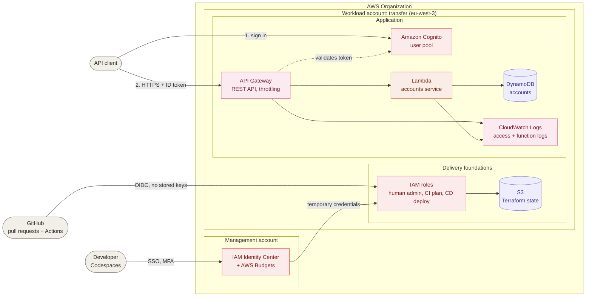

# Serverless Transfer Saga on AWS

> 🚧 **Work in progress** — this project is built step by step. See the [roadmap](#roadmap).

An event-driven, serverless money-transfer system on AWS, built as a portfolio project to demonstrate cloud architecture practices: distributed transactions (Saga), event-driven design, resilience, security and cost awareness.

> ⚠️ **Simulation only.** This project uses fictitious accounts and data. It does not process real payments.

## Goals

- Design a distributed transaction with compensation (Saga pattern) using managed AWS services.
- Apply event-driven patterns: pub/sub, queues with dead-letter handling, outbox, CQRS.
- Build in resilience (timeouts, retries, circuit breaker, bulkheads, throttling) and observability.
- Follow security best practices: least privilege, encryption, no long-lived credentials.
- Document every significant decision as an Architecture Decision Record (ADR).
- Review the final architecture against the six pillars of the AWS Well-Architected Framework.

## Functional scope

A user transfers money between two fictitious accounts:

1. A fraud check is performed (simulated, intentionally unreliable external service).
2. The source account is debited, then the target account is credited.
3. If a step fails, previous steps are compensated.
4. The user is notified, and can consult the transaction history.

## Architecture

The overview below shows what is **built so far** and grows with each phase. Detailed views by concern are in [`docs/architecture`](docs/architecture/).

**Current state: phase 1 complete (synchronous API)**

Deployed and tested end to end at the end of phase 1. To save costs, the `dev` application is destroyed between working sessions and redeployed by the pipeline when needed; the delivery foundations stay in place.



| View | Content |
|---|---|
| [Accounts and access](docs/architecture/accounts-and-access.md) | AWS Organization, IAM Identity Center, roles, break-glass access |
| [CI/CD](docs/architecture/ci-cd.md) | Pull-request and deployment pipelines, OIDC authentication, repository and environment protection |
| [Accounts API](docs/architecture/accounts-api.md) | Authentication, request flow, routes, permissions, logs and throttling of the accounts API |
| [Transfer Saga](docs/architecture/transfer-saga.md) | Design of phase 2: state machine, compensation, idempotency, data model (in progress) |

## Roadmap

- [x] **Phase 0** — Repository, AWS account security, Terraform foundations
  - [x] Repository with protected `main` branch and pull-request workflow
  - [x] Reproducible development environment (dev container)
  - [x] Multi-account setup, IAM Identity Center, MFA, cost budget ([ADR-0002](docs/adr/0002-aws-account-structure-and-access-management.md))
  - [x] Terraform remote state in S3 and GitHub Actions authentication with OIDC ([ADR-0003](docs/adr/0003-terraform-state-and-pipeline-authentication.md))
  - [x] CI pipeline: lint and `terraform plan` on every pull request, required before merge
  - [x] CD pipeline: manual `terraform apply` from `main`, in the protected `dev` environment with approval
- [x] **Phase 1** — Synchronous API (API Gateway, Lambda, DynamoDB, Cognito)
  - [x] DynamoDB accounts table
  - [x] Accounts Lambda function (Python) with unit tests in CI ([ADR-0004](docs/adr/0004-one-lambda-function-per-service.md))
  - [x] Lambda function infrastructure: least-privilege role, log group with retention
  - [x] API Gateway REST API: routes, throttling, access logs ([ADR-0005](docs/adr/0005-api-gateway-rest-api.md))
  - [x] Cognito authentication: user pool, API authorizer ([ADR-0006](docs/adr/0006-api-authentication-with-cognito.md))
  - [x] Authorization: users only access their own accounts ([ADR-0007](docs/adr/0007-authorization-by-account-ownership.md))
  - [x] Deployment and end-to-end tests ([`scripts/e2e-accounts.sh`](scripts/e2e-accounts.sh))
- [ ] **Phase 2** — Transfer Saga with compensation (Step Functions), idempotency
  - [x] Design: Saga orchestration, asynchronous API, idempotency ([ADR-0008](docs/adr/0008-transfer-saga-orchestrated-with-step-functions.md))
  - [ ] Transfers table and API (`POST` / `GET /transfers`), idempotency key
  - [ ] Saga steps: fraud check, debit, credit, compensation
  - [ ] Step Functions state machine
  - [ ] API routes, deployment and end-to-end tests of failure scenarios
- [ ] **Phase 3** — Event-driven communication (EventBridge, SQS, DLQ, outbox)
- [ ] **Phase 4** — CQRS read model
- [ ] **Phase 5** — Resilience and observability
- [ ] **Phase 6** — Security hardening
- [ ] **Phase 7** — Well-Architected review, cost estimate, final documentation

## Documentation

Architecture Decision Records:

| ADR | Decision |
|---|---|
| [0001](docs/adr/0001-use-terraform-for-infrastructure-as-code.md) | Use Terraform for Infrastructure as Code |
| [0002](docs/adr/0002-aws-account-structure-and-access-management.md) | AWS account structure and access management |
| [0003](docs/adr/0003-terraform-state-and-pipeline-authentication.md) | Terraform remote state and pipeline authentication |
| [0004](docs/adr/0004-one-lambda-function-per-service.md) | One Lambda function per service |
| [0005](docs/adr/0005-api-gateway-rest-api.md) | Amazon API Gateway REST API |
| [0006](docs/adr/0006-api-authentication-with-cognito.md) | API authentication with Amazon Cognito |
| [0007](docs/adr/0007-authorization-by-account-ownership.md) | Authorization by account ownership |
| [0008](docs/adr/0008-transfer-saga-orchestrated-with-step-functions.md) | Transfer Saga orchestrated with AWS Step Functions |

## Tech stack

| Area | Choice |
|---|---|
| Cloud | AWS, dedicated workload account in an AWS Organization |
| Access | IAM Identity Center, temporary credentials only |
| Application code | Python 3.13 on AWS Lambda, tested with pytest and moto |
| Infrastructure as Code | Terraform |
| Terraform state | Amazon S3 (versioned, encrypted, native locking) |
| CI/CD | GitHub Actions, OIDC authentication (no stored AWS keys) |
| Dev environment | GitHub Codespaces (dev container) |

## Getting started

Open the repository in GitHub Codespaces: the dev container provides Python, Terraform, TFLint and the AWS CLI.

Then sign in to AWS with IAM Identity Center (no access keys are used):

```bash
# First time only: create a CLI profile for the workload account
aws configure sso --use-device-code

# When the session has expired
aws sso login --profile <your-profile> --use-device-code

# Check which identity is in use
aws sts get-caller-identity --profile <your-profile>
```

## License

[MIT](LICENSE)
