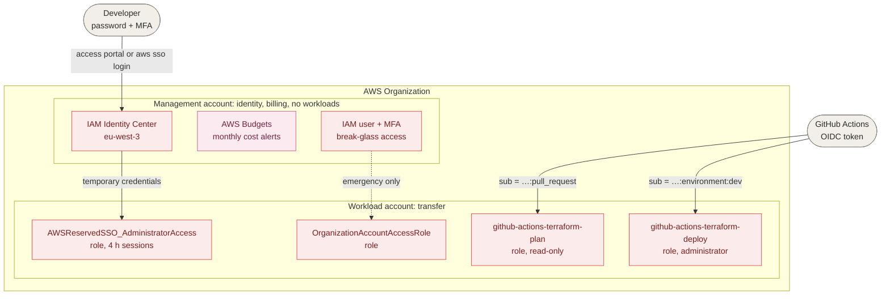

# Accounts and access

This view shows how the AWS accounts are organized and how humans and the CI/CD pipeline access them.
Decisions: [ADR-0002](../adr/0002-aws-account-structure-and-access-management.md), [ADR-0003](../adr/0003-terraform-state-and-pipeline-authentication.md).

## Who can access what

| Identity | Authenticates with | Role assumed | Account | Permissions |
|---|---|---|---|---|
| Developer | IAM Identity Center (portal or `aws sso login`), MFA | `AWSReservedSSO_AdministratorAccess_…` | management or `transfer` | Administrator |
| CI on a pull request | GitHub OIDC token, `sub` ending in `:pull_request` | `github-actions-terraform-plan` | `transfer` | Read-only + state lock |
| CD in environment `dev` | GitHub OIDC token, `sub` ending in `:environment:dev` | `github-actions-terraform-deploy` | `transfer` | Administrator |
| Break-glass | IAM user with MFA in the management account | `OrganizationAccountAccessRole` | `transfer` | Administrator |

No identity uses long-lived access keys: every access goes through a role and temporary credentials.
