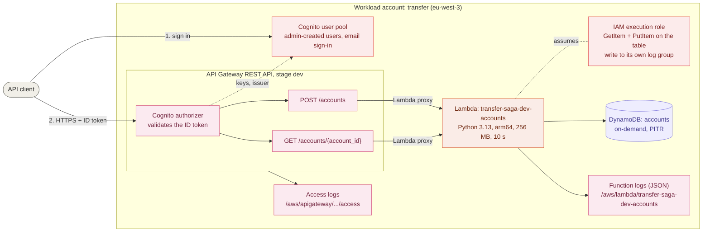
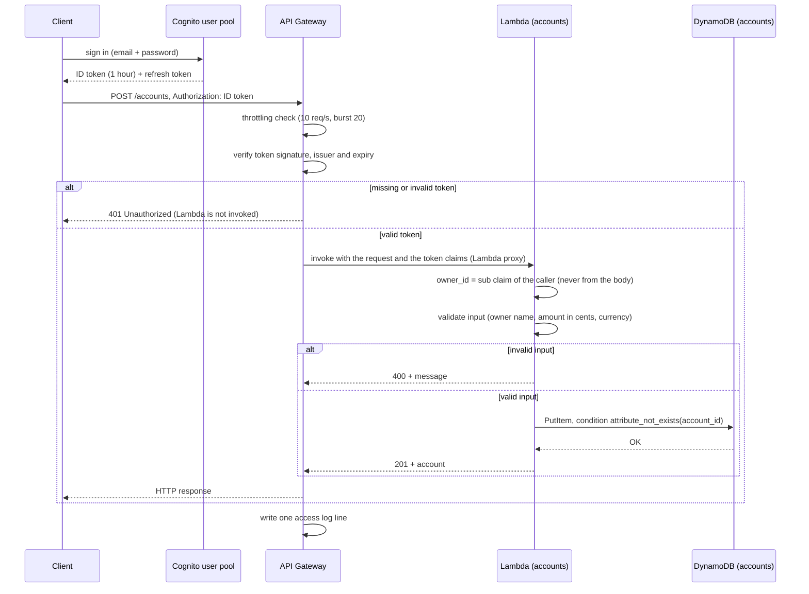
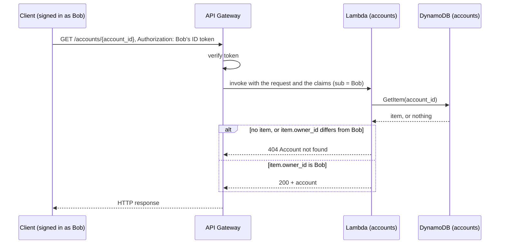

# Accounts API

This view shows how a request to the accounts API is processed.
Decisions: [ADR-0004](../adr/0004-one-lambda-function-per-service.md) (one function per service), [ADR-0005](../adr/0005-api-gateway-rest-api.md) (API Gateway REST API), [ADR-0006](../adr/0006-api-authentication-with-cognito.md) (authentication with Cognito), [ADR-0007](../adr/0007-authorization-by-account-ownership.md) (authorization by account ownership).

## Components

## Request flow: create an account

## Request flow: read an account

Each user can only read their own accounts. An account that belongs to someone else gets exactly the same answer as an account that does not exist.

## Routes

| Method and path | Success | Errors |
|---|---|---|
| `POST /accounts` | `201` with the new account | `400` invalid input, `401` missing or invalid token, `429` throttled, `500` internal error |
| `GET /accounts/{account_id}` | `200` with the account, if the caller owns it | `400` invalid id, `401` missing or invalid token, `404` unknown account **or account of another user**, `429` throttled, `500` internal error |

Amounts are integers in minor units (cents). Internal errors return a generic message; details are written to the function logs only.

## Security and operations

| Concern | Implementation |
|---|---|
| Authentication | Cognito user pool, admin-created users only, strong password policy, optional TOTP MFA. API Gateway rejects requests without a valid ID token (`401`) before invoking Lambda. |
| Authorization | An account belongs to the user who created it (`owner_id` = Cognito `sub`, taken from the verified token). Users can only read their own accounts; other accounts return `404`, like unknown ones. Requests without a verified identity are refused (`401`) by the function too (defense in depth). |
| Least privilege | The function role allows only `GetItem` and `PutItem` on the accounts table, and writing to its own log group. API Gateway may invoke the function only for these two routes of this API. |
| Rate limiting | Stage throttling on every method: 10 requests per second, bursts of 20. Excess requests receive `429 Too Many Requests`. |
| Data integrity | Conditional write: an existing account is never overwritten. Amounts are integers, never floats. |
| Logs | JSON access logs (one line per request) and JSON function logs, both kept 14 days. |
| Metrics | API Gateway method metrics (count, latency, 4xx, 5xx) and Lambda metrics in CloudWatch. |
| Backups | DynamoDB point-in-time recovery (35 days). |
