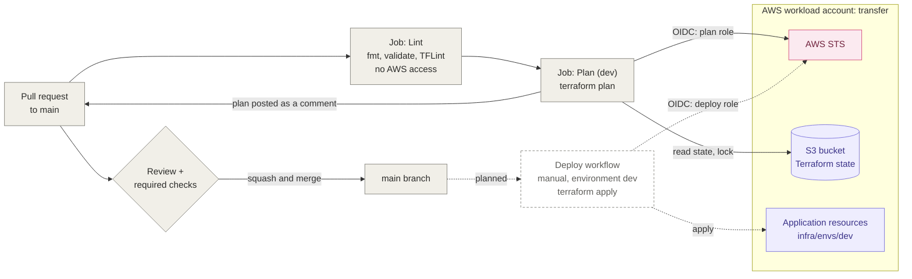
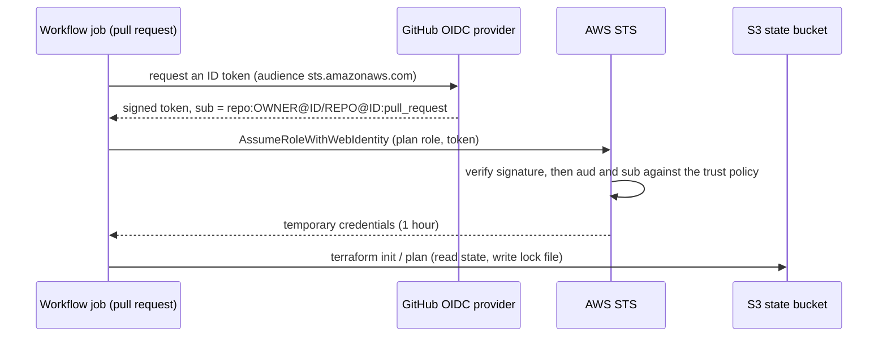

# CI/CD

This view shows how infrastructure changes go from a pull request to AWS.
Decision: [ADR-0003](../adr/0003-terraform-state-and-pipeline-authentication.md).

## Delivery flow

Dashed elements are not built yet.

## Authentication of a pull-request workflow

## Repository protection

- `main` is protected by a ruleset: no direct push, no force push, linear history.
- Every change goes through a pull request, merged with **squash and merge**.
- The **Lint** and **Plan (dev)** checks must pass, on a branch up to date with `main`.
- Pull requests from forks do not run the plan job: they receive no secrets and cannot assume the AWS role.
