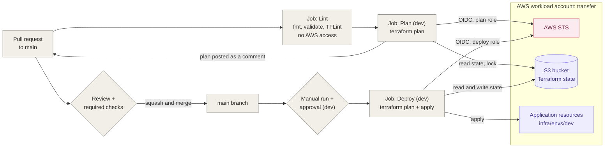
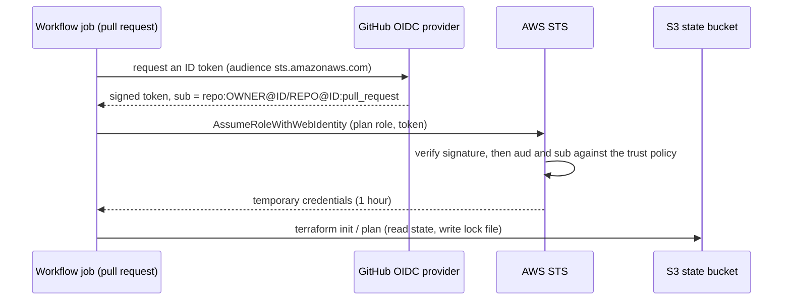

# CI/CD

This view shows how infrastructure changes go from a pull request to AWS.
Decision: [ADR-0003](../adr/0003-terraform-state-and-pipeline-authentication.md).

## Delivery flow

## Workflows

| Workflow | Trigger | Job | AWS role | What it does |
|---|---|---|---|---|
| `terraform-plan.yml` | every pull request to `main` | Lint | none | `fmt`, `validate` and TFLint on every configuration |
| | | Plan (dev) | plan role (read-only) | `terraform plan`, posted as a pull-request comment |
| `tests.yml` | every pull request to `main` | Unit tests | none | `pytest` on the Lambda code, AWS mocked with moto |
| `terraform-deploy.yml` | manual (`workflow_dispatch`), from `main`, action `apply` | Deploy (dev) | deploy role | `terraform plan`, shown in the job summary, then `terraform apply` of that exact plan |
| | same workflow, action `destroy` | Destroy (dev) | deploy role | `terraform plan -destroy`, shown in the job summary, then applied: every resource of `infra/envs/dev` is deleted; the bootstrap is not affected |

To save costs, the `dev` application is destroyed between working sessions with the `destroy` action, and redeployed with `apply`. Both go through the same approval and leave a run in the history of the repository.

The reviewer approves the deployment before the job computes its plan. This is accepted because the same code was already planned and reviewed in its pull request. Separating plan and apply into two jobs, with the approval between them, would require an additional role and environment.

## Authentication of a pull-request workflow

## Repository protection

- `main` is protected by a ruleset: no direct push, no force push, linear history.
- Every change goes through a pull request, merged with **squash and merge**.
- The **Lint**, **Plan (dev)** and **Unit tests** checks must pass, on a branch up to date with `main`.
- Pull requests from forks do not run the plan job: they receive no secrets and cannot assume the AWS role.

## Deployment protection

The GitHub environment `dev` is the second lock on the deploy role, in addition to the `sub` condition of its trust policy:

- **Deployment branches:** only `main`, so only reviewed and merged code can be deployed.
- **Required reviewer:** every deployment waits for a manual approval.
- **Environment secret:** the deploy role ARN is readable only by jobs running in this environment.
- **Concurrency:** one deployment at a time; a deployment in progress is never cancelled.
