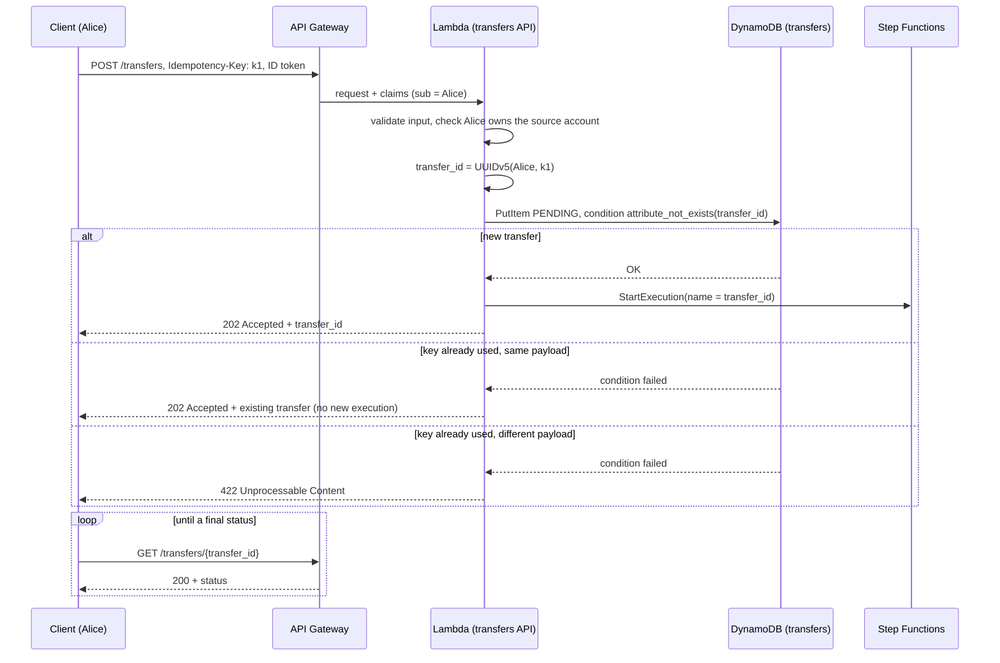
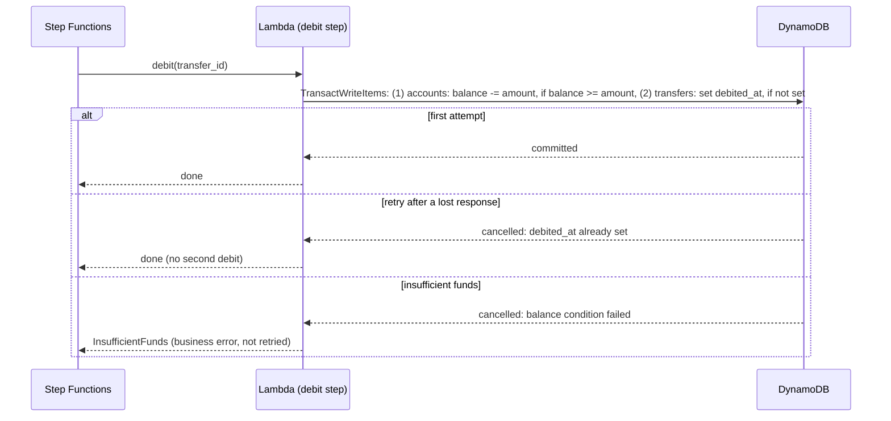

# Transfer Saga

> **Design of phase 2, being implemented.** This view describes the target design; it is updated as each part is built.

This view shows how a transfer between two accounts is processed.
Decision: [ADR-0008](../adr/0008-transfer-saga-orchestrated-with-step-functions.md) (Saga orchestrated with Step Functions). Authentication and authorization follow [ADR-0006](../adr/0006-api-authentication-with-cognito.md) and [ADR-0007](../adr/0007-authorization-by-account-ownership.md).

## Components

## State machine

Transient errors (throttling, service errors, fraud service unavailable) are retried by Step Functions with exponential backoff and jitter. Business errors (fraud refused, insufficient funds) are not retried.

## Request flow: create a transfer

## Idempotent steps

Each money movement is one DynamoDB transaction that changes the balance **and** marks the step as done on the transfer. If Step Functions retries a step that had in fact succeeded, the mark already exists, the transaction is cancelled without any change, and the step reports success.

## Data model

**`transfers` table**, partition key `transfer_id`:

| Attribute | Description |
|---|---|
| `transfer_id` | UUID v5 of the owner and the idempotency key |
| `owner_id` | Cognito `sub` of the caller (owner of the source account) |
| `source_account_id`, `target_account_id` | accounts involved |
| `amount`, `currency` | integer amount in minor units, currency of both accounts |
| `status` | `PENDING`, `COMPLETED`, `REJECTED`, `FAILED`, `COMPENSATED` |
| `debited_at`, `credited_at`, `refunded_at` | step marks, set by the step transactions (idempotency) |
| `failure_reason` | for `REJECTED`, `FAILED` and `COMPENSATED` |
| `created_at`, `updated_at` | timestamps |

## Routes

| Method and path | Success | Errors |
|---|---|---|
| `POST /transfers` | `202` with the transfer (new, or existing for the same idempotency key) | `400` invalid input or missing `Idempotency-Key`, `401` / `403` authentication, `404` source account not found or not owned, `422` key reused with a different payload, `429` throttled |
| `GET /transfers/{transfer_id}` | `200` with the transfer and its status, if the caller owns it | `400` invalid id, `401` / `403` authentication, `404` unknown transfer or transfer of another user |
