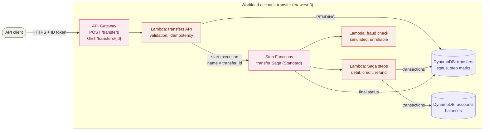
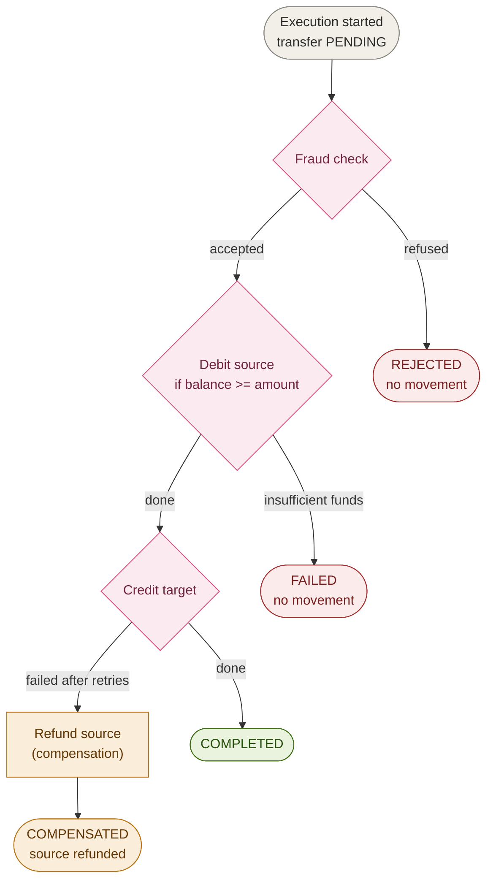
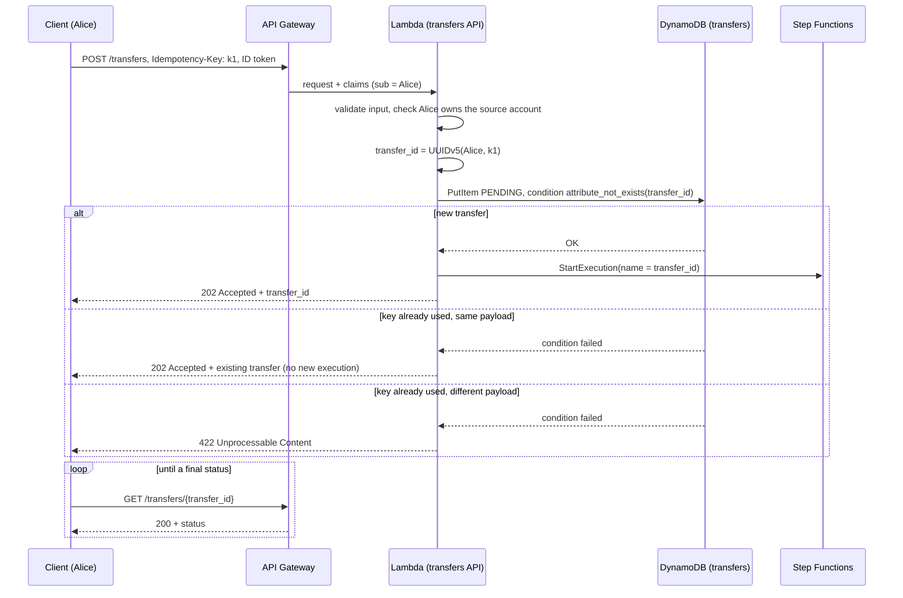
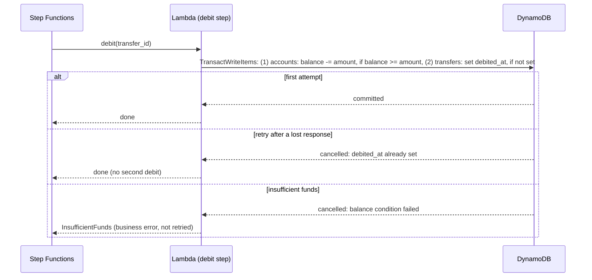

# Transfer Saga

This view shows how a transfer between two accounts is processed.
Decision: [ADR-0008](../adr/0008-transfer-saga-orchestrated-with-step-functions.md) (Saga orchestrated with Step Functions). Authentication and authorization follow [ADR-0006](../adr/0006-api-authentication-with-cognito.md) and [ADR-0007](../adr/0007-authorization-by-account-ownership.md).

## Components

## State machine

Transient errors (throttling, service errors, fraud service unavailable) are retried by Step Functions with exponential backoff and jitter. Business errors (fraud refused, insufficient funds) are not retried.

### Implementation of the state machine

| State | Type | Integration | On error |
|---|---|---|---|
| `LoadTransfer` | Task | DynamoDB `GetItem`, direct (no Lambda) | retried |
| `FraudCheck` | Task | Lambda `fraud-check` | outages retried 4 times, then `MarkFailed` |
| `FraudDecision` | Choice | — | `ACCEPTED` → `Debit`, otherwise `MarkRejected` |
| `Debit` | Task | Lambda `saga-steps` | transient errors retried; `InsufficientFunds` → `MarkFailed`; anything else → `InvariantBroken` |
| `Credit` | Task | Lambda `saga-steps` | transient errors retried; any refusal after retries → `Refund`; `StepNotAllowed` → `InvariantBroken` |
| `Refund` | Task | Lambda `saga-steps` | retried up to 8 times (it must not fail); then `InvariantBroken` |
| `MarkCompleted`, `MarkRejected`, `MarkFailed`, `MarkCompensated` | Task | DynamoDB `UpdateItem`, direct | retried on throttling |
| `InvariantBroken` | Fail | — | the transfer stays `PENDING`; to be investigated |

**Never guess the outcome of a debit.** If the debit fails for a technical reason after every retry (for example, the function times out), the money may or may not have moved. Recording `FAILED` could hide a debit; the execution stops in `InvariantBroken` instead, and the transfer stays `PENDING` until someone investigates. A CloudWatch alarm on failed executions is added in phase 5.

**Final statuses are guarded by the step marks.** Each `Mark…` state only writes its status if the marks agree with it: `COMPLETED` requires `credited_at`, `COMPENSATED` requires `refunded_at`, `FAILED` and `REJECTED` require that no debit happened. A replayed `Mark…` state is accepted when the status is already the same.

**Least privilege.** The state machine may invoke only the two Saga functions and read or update only the `transfers` table. The `saga-steps` function may read transfers and update accounts and transfers; the `fraud-check` function has no data access. Execution logs record errors only, without execution data, so that balances and identities stay out of the logs.

## Request flow: create a transfer

## Idempotent steps

Each money movement is one DynamoDB transaction that changes the balance **and** marks the step as done on the transfer. If Step Functions retries a step that had in fact succeeded, the mark already exists, the transaction is cancelled without any change, and the step reports success.

### How a step knows it was already done

The mark (`debited_at`, `credited_at`, `refunded_at`) and the money move are written **in the same transaction**: both succeed or neither does. So "mark present" always means "step done".

| Situation | Transaction | Result of the step |
|---|---|---|
| First attempt, conditions met | committed: money moved **and** mark set | `done` |
| Retry after the step already succeeded (for example, a lost response) | **cancelled**: the mark condition fails, nothing is written | `already_done`, no second move |
| Business condition not met (balance too low, closed target account) | **cancelled**: the account condition fails | business error (`InsufficientFunds`, `CreditRejected`) |
| Two transactions on the same items at the same time | **cancelled** with `TransactionConflict` | `TransientError`, retried by Step Functions |

When DynamoDB cancels a transaction, it returns the reason **per item** (`CancellationReasons`); the step reads the transfer again to tell "already done" from a refusal.

Reading the mark **before** writing is only a shortcut: between the read and the write, another attempt could pass. The condition **inside** the transaction is what guarantees that money moves once; a unit test simulates this race.

### Conditions of each step

| Step | Account condition | Transfer condition | Refused account → |
|---|---|---|---|
| Debit | source exists, same currency, `balance >= amount` | not debited yet, status `PENDING` | `InsufficientFunds` |
| Credit | target exists, same currency, not `CLOSED` | debited, not credited, not refunded, status `PENDING` | `CreditRejected` |
| Refund | source exists | debited, not credited, not refunded, status `PENDING` | `StepNotAllowed` |

A target account with `status = CLOSED` cannot receive money. There is no API to close an account yet: an administrator sets it directly in DynamoDB, which is how the end-to-end tests trigger a compensation.

### Errors returned to Step Functions

| Error | Kind | Handling in the state machine |
|---|---|---|
| `FraudServiceUnavailable` | transient (simulated outage of the fraud service) | retried with backoff |
| `TransientError` | transient (transaction conflict) | retried with backoff |
| `InsufficientFunds` | business | not retried → `FAILED` |
| `CreditRejected` | business | not retried → refund → `COMPENSATED` |
| `StepNotAllowed` | invariant broken (should never happen) | not retried → execution fails, to be investigated |

The fraud check service rejects amounts above a threshold (5,000.00 by default) and fails at random with a configurable rate, to exercise retries.

## Data model

**`transfers` table**, partition key `transfer_id`:

| Attribute | Description |
|---|---|
| `transfer_id` | UUID v5 of the owner and the idempotency key |
| `owner_id` | Cognito `sub` of the caller (owner of the source account) |
| `source_account_id`, `target_account_id` | accounts involved |
| `amount`, `currency` | integer amount in minor units, currency of both accounts |
| `status` | `PENDING`, `COMPLETED`, `REJECTED`, `FAILED`, `COMPENSATED` |
| `debited_at`, `credited_at`, `refunded_at` | step marks, set by the step transactions (idempotency) |
| `failure_reason` | for `REJECTED`, `FAILED` and `COMPENSATED` |
| `created_at`, `updated_at` | timestamps |

`status` describes the **whole transfer**; the marks describe the **progress of the steps**:

| `status` | `debited_at` | `credited_at` | `refunded_at` | Meaning |
|---|---|---|---|---|
| `PENDING` | — | — | — | in progress, no money moved |
| `PENDING` | ✓ | — | — | in progress, money "in flight" |
| `COMPLETED` | ✓ | ✓ | — | transfer done |
| `REJECTED` | — | — | — | refused by the fraud check |
| `FAILED` | — | — | — | debit refused (insufficient funds) |
| `COMPENSATED` | ✓ | — | ✓ | credit refused, source refunded |

The history of each execution in Step Functions gives the detail of every step (attempts, errors, durations).

## Routes

| Method and path | Success | Errors |
|---|---|---|
| `POST /transfers` | `202` with the transfer (new, or existing for the same idempotency key) | `400` invalid input or missing `Idempotency-Key`, `401` / `403` authentication, `404` source account not found or not owned, `422` key reused with a different payload, `429` throttled |
| `GET /transfers/{transfer_id}` | `200` with the transfer and its status, if the caller owns it | `400` invalid id, `401` / `403` authentication, `404` unknown transfer or transfer of another user |

## Implementation notes

- **Idempotency key:** required header `Idempotency-Key` (case-insensitive name), 1 to 255 printable characters. It is **generated by the client** (web or mobile app, script), typically a UUID, **once per user intention**: a retry of the same request reuses the key; a new transfer, even identical, uses a new key. The server cannot generate it: if a response is lost, the client would not know the key to send again. `transfer_id = UUIDv5(project namespace, owner_id + ":" + key)`: two users can use the same key without collision.
- **Replay:** a request with an already used key is compared on `source_account_id`, `target_account_id` and `amount`. Same values: `202` with the existing transfer. Different values: `422`.
- **Self-healing start:** if a previous attempt recorded the transfer but failed to start the Saga, a replay with the same key starts it. The execution name (`transfer_id`) prevents a second execution.
- **Race between two identical requests:** the conditional write lets only one of them create the transfer; the other one reads it back and answers as a replay.
- **Checks before recording a transfer:** the caller owns the source account (`404` otherwise, same answer as an unknown account), the target account exists (`404`), both accounts have the same currency (`400`). The balance is **not** checked here: the debit step of the Saga does it atomically.
- **Least privilege of the transfers function:** read accounts (`GetItem`), read and create transfers (`GetItem`, `PutItem`), start the transfer Saga (`states:StartExecution` on this state machine only). It never moves money: only the Saga steps do.

## Known limitation

If the debit or the credit fails for a **technical** reason after every retry (for example, a function timeout), the outcome of the step is unknown. The execution stops in `InvariantBroken` and the transfer stays `PENDING` until someone investigates; the alarm on failed executions comes in phase 5.

A possible improvement is an automatic **reconciliation**: wait a few seconds, read the transfer again, and continue from the step marks (`debited_at` present: continue to the credit; absent: `FAILED` with certainty). The marks make this safe, since they are written in the same transaction as the money move. Not implemented, as such failures are rare and visible.

## End-to-end tests

[`scripts/e2e-transfers.sh`](../../scripts/e2e-transfers.sh) tests the deployed Saga with fresh accounts. Results at the end of phase 2 (2026-11-13): **26 checks passed**.

| Scenario | How it is triggered | Checked | Result |
|---|---|---|---|
| `COMPLETED` | regular transfer of 30.00 | status, source and target balances | ✅ |
| Idempotency | same key resent; same key with another amount; no key | same `transfer_id` and no second debit; `422`; `400` | ✅ |
| `REJECTED` | 6,000.00, above the fraud threshold | status, reason, balance unchanged | ✅ |
| `FAILED` | 90.00 from an account holding 50.00 | status, `InsufficientFunds`, balance unchanged | ✅ |
| `COMPENSATED` | target account closed (`CLOSED`) in DynamoDB by an administrator | status, `CreditRejected`, `debited_at` and `refunded_at` set, balances restored | ✅ |
| Authorization | Bob reads Alice's transfer; Alice transfers from Bob's account | `404`, Bob's balance unchanged | ✅ |

The simulated fraud service fails 20 % of the time; with 4 retries, the probability that it makes a transfer fail is about 3 in 10,000.
